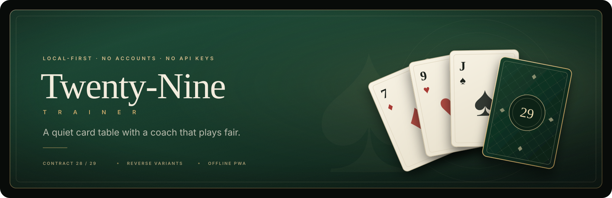
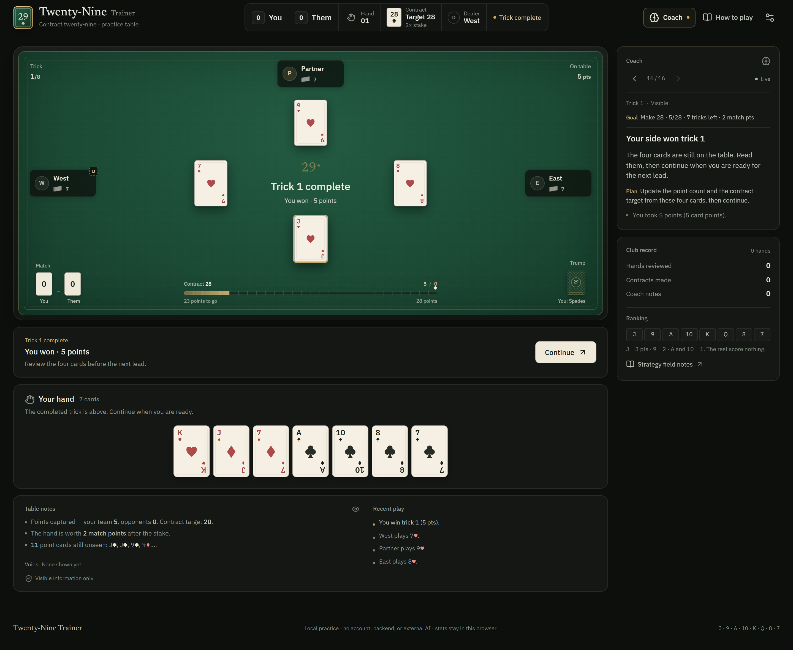
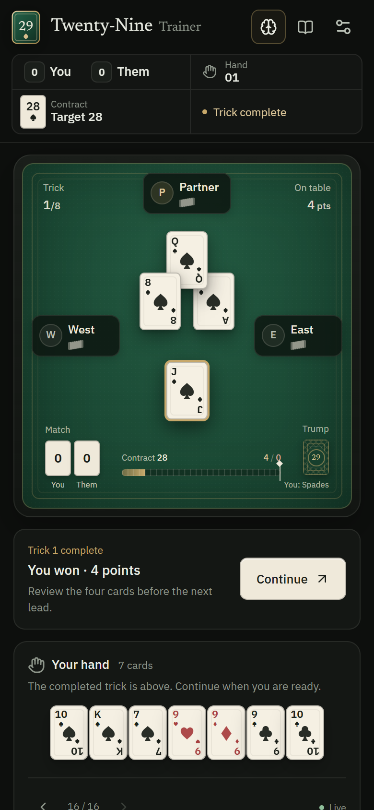
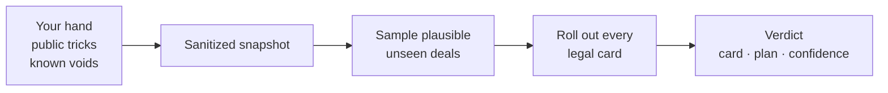

<div align="center">
  

  <br /><br />

  **Real partnership Twenty-Nine. Search-based bots. A coach that shows its work.**

  <sub>No backend · no accounts · no API keys · everything runs in your browser</sub>

  <br /><br />

  [](https://react.dev) [](https://www.typescriptlang.org) [](https://vite.dev) [](https://vite-pwa-org.netlify.app) [](#install-and-play-offline)

  <br />

  [The table](#the-table) · [Rules in one screen](#rules-in-one-screen) · [The fair coach](#a-coach-that-cannot-cheat) · [Run it locally](#run-it-locally)
</div>

> The fun of Twenty-Nine is reading the table. The trainer should sharpen that read, not play the hand for you.

## The table



<p align="center"><sub>A complete trick stays on the table until you are ready. The coach explains the public read; the contract race shows exactly how far the hand has to travel.</sub></p>

<table>
  <tr>
    <td width="34%" align="center">
      
    </td>
    <td width="66%" valign="middle">
      <h3>Made for one thumb</h3>
      <p>The phone layout is not a shrunken desktop. The match score and trump stack are card-sized objects on the felt, the contract race fills the space between them, and the primary controls stay at 44px.</p>
      <ul>
        <li>Readable down to <strong>320px</strong>, with no horizontal scroll.</li>
        <li>Score cards, trump, and table labels clear of the brass inner border.</li>
        <li>The coach, table notes, and review stack into a single legible column.</li>
        <li>Install it full-screen and play offline like a native app.</li>
      </ul>
    </td>
  </tr>
</table>

## What makes it different

<table>
  <tr>
    <td width="33%" valign="top">
      <h3>♠ A coach that cannot cheat</h3>
      <p>The evaluator is stripped of every hidden hand and the unrevealed trump before it runs. It reasons from your cards, the public tricks, and exposed voids — the same information you have.</p>
    </td>
    <td width="33%" valign="top">
      <h3>♦ Bots that think in deals</h3>
      <p>Each bot samples plausible unseen deals, rolls out every legal card against the same set, and plays the best expected move. No peeking, no random bluffs.</p>
    </td>
    <td width="33%" valign="top">
      <h3>♥ A table, not a dashboard</h3>
      <p>Physical card stacks for the score, a 28/29 contract race, a patterned trump back that flips on reveal, and a review that reads like a hand ledger.</p>
    </td>
  </tr>
</table>

## Everything in the box

**The game**
- The full flow: four-card opening deal, auction, trump selection, second deal, hidden trump, follow-suit play, eight tricks, and match scoring.
- Optional rules, each switchable in **Practice settings**: royal pair, seventh-card trump, double and redouble, Reverse (no trump), Reverse with trump, and the last-trick bonus.
- Follow-suit and the reveal obligation are enforced by the UI, so a revoke or an illegal discard cannot happen by accident.
- Table cues: auction pauses, trick pauses, trump-reveal announcements, and a floating 29 mark at the centre.

**The table**
- A card-stack match scoreboard whose suit mark carries the sign, and a 28/29-point race with the bidding side filling from the left and the defence from the right.
- A face-down trump card that flips when the suit is revealed. If you are void in the led suit and trump is still hidden, you may discard without revealing, or tap the card to expose it.
- Exposing the hidden contract is a commitment: the player who reveals it must play a trump in that trick if one is available. Discarding without revealing keeps trump hidden and carries no such obligation.
- Seat chips with avatars, card fans, dealer tokens, and auction wins instead of status sentences.
- Coach tip history with previous/next arrows and a Latest jump back to live advice.
- Interactive trick timeline, local session statistics, and layouts for phone, tablet, and desktop — down to 320px.

**The brain**
- **Search-based bots:** partner-aware bidding plus determinized Monte Carlo card play. Once the contract mode is public, the last four tricks are solved exactly with double-dummy minimax.
- **Hybrid coach:** a visible-card rule tip starts every turn; the sampled comparison then upgrades it to a model verdict when there is a clear edge. Close calls keep the rule as the tie-break, and the tip shows both views.
- **Off-turn table reads:** while someone else is thinking, the coach stops giving card advice and reads the public table instead — contract count, known voids, likely suit plan, and what to watch.
- **Void ledger:** every exposed void is listed by seat and suit in the Table notes strip, beside the visible-card reading and recent play.
- **Deep review:** every recorded decision is re-evaluated after the hand, with the model's alternative and an estimate of how it changes the chance of making or defeating the contract. Review can be re-run on demand.
- **Consistent suit ink:** hearts and diamonds are red everywhere — cards, coach text, event logs, and review copy — while black suits use the light ink on dark surfaces.
- **Off switch:** hide the coach and every model panel for a clean practice table.

**The app**
- **Autosave and resume:** the table is saved after every bid and card. Returning offers **Continue match** or **Start new match**, and **Restart match** starts a fresh 0–0.
- **Installable PWA:** manifest, maskable icons, and a Workbox service worker precache the full app. Install from the top bar, Practice settings, or the browser menu.
- **Offline-first:** launch it full-screen with no connection. No server round-trip is needed to deal, bid, play, or review.
- Everything else stays local too: preferences and session statistics live in browser storage, with no analytics or tracking.

## Rules in one screen

Card order is **J > 9 > A > 10 > K > Q > 8 > 7**. The usual opening bid is 16; the default hand has 28 card points. The first team to **+6 game points** wins, and a team at **−6** loses.

| Rank | **J** | **9** | **A** | **10** | **K** | **Q** | **8** | **7** |
|:---|:---:|:---:|:---:|:---:|:---:|:---:|:---:|:---:|
| Points | **3** | **2** | 1 | 1 | 0 | 0 | 0 | 0 |

In Reverse, the order flips to **7 high and J low**; point values stay the same.

If you expose the hidden contract while void, you must play a trump in that trick if you hold one. The rule applies to normal trump and Reverse with trump; a no-trump Reverse has no such obligation. You may instead discard without exposing, keeping the contract hidden for a later trick.

<table>
  <tr>
    <th align="left" width="24%">Optional rule</th>
    <th align="left">What it changes</th>
  </tr>
  <tr>
    <td><strong>Royal pair</strong></td>
    <td>Declare the K+Q of trump after your side wins a trick. The declaring side's target falls by 4, never below the 16-point opening minimum; a defender's declaration raises the bidding team's target by 4.</td>
  </tr>
  <tr>
    <td><strong>Seventh-card trump</strong></td>
    <td>The bidder lets their seventh dealt card set trump sight unseen. It stays out of their hand until trump is revealed and cannot be led unless it is their last card.</td>
  </tr>
  <tr>
    <td><strong>Double &amp; redouble</strong></td>
    <td>After trump is set, defenders can double to 2 match points and the declaring side can redouble to 4. The contract target does not change.</td>
  </tr>
  <tr>
    <td><strong>Reverse</strong></td>
    <td>A no-trump contract with a face-down 2 indicator. A player who is void may expose it; from that trick onward the ranking is 7 high and J low. A royal pair cannot be declared.</td>
  </tr>
  <tr>
    <td><strong>Reverse with trump</strong></td>
    <td>The bidder names a trump suit and keeps the flipped ranking once revealed. The trump 7 is the strongest card on the table and the trump J is the weakest. The royal pair is allowed after the reveal.</td>
  </tr>
  <tr>
    <td><strong>Last-trick bonus</strong></td>
    <td>The winner of the eighth trick earns one additional point.</td>
  </tr>
</table>

Single-hand declarations and the Bangladesh-specific bidding sequence are not implemented.

## A coach that cannot cheat

The evaluator never receives the real hidden hands. Before any simulation, the game is reduced to a sanitized snapshot:

<table>
  <tr>
    <th align="left" width="50%">What the coach sees</th>
    <th align="left" width="50%">What it never sees</th>
  </tr>
  <tr>
    <td>Your hand · cards played · exposed voids · contract and stake · whose turn it is · the score</td>
    <td>Opponents' hands · a hidden trump suit · the order of undealt cards</td>
  </tr>
</table>



Every candidate move is tested against the **same** sampled deals, which keeps comparisons stable. When trump is public and four or fewer tricks remain, the rollout is replaced by an exact double-dummy solve on each sampled deal. That removes most of the late-game noise and lets the review separate a genuinely better endgame play from a lucky one.

The scores are teaching estimates, not a perfect solver. The default is **200 sampled deals** in the live coach and **200** in the full-hand review; both are adjustable. The bots can use 24, 48, 96, or 200 deals per move, or be switched to a faster heuristic. More samples improve stability but take longer. Unknown trump is modelled from plausible opening hands, and the uncertainty is shown with the result.

## Install and play offline

1. Open the app in a Chromium-based browser, Safari, or Edge.
2. Choose **Install** in the top bar (or **Practice settings → Install app**).
3. On iPhone or iPad, use **Share → Add to Home Screen**.
4. Launch from the home screen or app list — the table opens full-screen and works without a connection.

The service worker precaches the app shell, game, fonts, and icons. `public/_headers` keeps the service worker and manifest revalidating, so a new deployment is picked up without leaving players on a stale build.

## Run locally

**Requirements:** Node.js 22.12+ (`.nvmrc` pins 22.16.0) and pnpm 10.7.1 (pinned in `package.json`).

```bash
corepack enable
pnpm install
pnpm dev
```

Open the local URL printed by Vite.

```bash
pnpm typecheck   # TypeScript project build check
pnpm build       # production bundle in dist/
pnpm preview     # serve the production build
```

The PWA install icons are generated from `public/logo.svg`:

```bash
pnpm generate-pwa-assets
```

## Deploy to Cloudflare Pages

The project is a static Vite SPA. `public/_redirects` supplies the SPA fallback, `public/_headers` adds security and cache headers, and `wrangler.jsonc` points Wrangler at `dist`.

1. Push the repository to GitHub.
2. In Cloudflare, open **Workers & Pages → Create application → Pages → Import an existing Git repository**.
3. Select the repository and use:
   - **Framework preset:** React (Vite) or None
   - **Build command:** `corepack pnpm install --frozen-lockfile && corepack pnpm build`
   - **Build output directory:** `dist`
   - **Node.js version:** 22.16.0 or newer on the Node 22 line
4. `pnpm-lock.yaml` is committed, so the frozen install is reproducible. Pushes to the production branch trigger a new build.

Or build and deploy with Wrangler:

```bash
pnpm build
npx wrangler pages deploy dist
```

No Cloudflare Worker, environment variables, database, or secret key is required. Game state, preferences, and session statistics stay in local browser storage.

## Architecture

| File | Role |
|:---|:---|
| `src/game.ts` | Pure rules, auction, trump reveal, trick resolution, bot policy, scoring, bid records, and deterministic coaching checks. |
| `src/coach.ts` | Visible-information insight engine: bid, trump, and play advice; suit and unseen-card reading; post-hand lessons. |
| `src/ai/evaluator.ts` | Sanitized belief states, unseen-deal sampling, move rollouts, and full-hand evaluation. |
| `src/ai/evaluator.worker.ts` | Background worker that keeps expensive strategy calculations off the UI thread. |
| `src/ai/search.ts` | Bot search budget and hidden-information fallback. |
| `src/ai/endgame.ts` | Exact double-dummy solve for the closing tricks. |
| `src/App.tsx` | Match strip, felt table, pause bar, decision dock, stake panel, coach rail, review, settings, resume prompt, install prompt, and local stats. |
| `src/persistence.ts` | Versioned local save, validation, restore, and clear helpers for the current game. |
| `src/useInstallPrompt.ts` | Captures the browser install prompt and reports standalone/iOS state. |
| `src/styles.css` | The club-table surface, typography, and responsive rules. |
| `PRODUCT.md` / `DESIGN.md` | Durable product truth and the visual system for future work. |
| `vite.config.ts` / `pwa-assets.config.ts` | PWA manifest, Workbox precache, and local icon generation. |
| `public/` | Logo and install icons, SPA fallback, and cache/security headers. |

The evaluator is deliberately separated from the UI. The worker only receives the player's own hand, public tricks, and publicly inferable information; actual opponent hands and hidden trump are stripped before analysis.

## Validation

```bash
pnpm install
pnpm typecheck
pnpm build
```

The production bundle is written to `dist/`. Commit `pnpm-lock.yaml` so future installs and Cloudflare Pages builds remain reproducible.

---

<div align="center">
  <sub>Built for the card table. No tracking, no accounts, no API keys.</sub>
</div>
